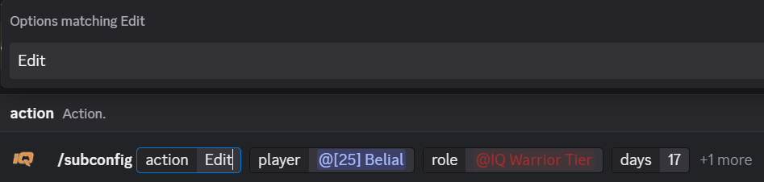

<h1 align="center">
  iQ GamerZ ELO

  A bot for matchmaking on Discord.
</h1>

  

<h1 align="center">
Commands
</h1>

## Index

- [Index](#índice)
- [Commands for administrators.](#admin-commands)
- [Commands for mods](#mod-commands)
- [What happened to the /win, /lose, and /mvp commands?](#what-happened-to-the-win-lose-and-mvp-commands)
- [How do I add or edit a subscription?](#how-do-i-add-or-edit-a-subscription)
- [How do I configure V1 and V2 roles?](#how-do-i-configure-V1-and-V2-roles)
- [How do I set up a lobby?](#how-do-i-set-up-a-lobby)

# EN 

## Admin commands:

* ***/register_role***
Set up, view, or disable the role that is automatically assigned upon registration.

* ***/ban***
Ban, unban or display all banned users.

* ***/admin_role***
Assign, remove or view Administrator/Scorer roles. **Available on the Dashboard.**

* ***/maps***
Add, remove or display maps.

* ***/ranks***
Show ELO roles and the points for a win, loss, and MVP.

* ***/elo_role***
Set or remove a role for an ELO range. **Available on the Dashboard.**

* ***/set_season***
Start a new season for this server. **Available on the Dashboard.**

* ***/reset_season***
End the active season and reset ELO. **Available on the Dashboard.**

* ***/change***
Change a player's season stats.

* ***/timeout***
Sets a timeout of 1 to 672 hours for a mandatory reason, without modifying statistics.

* ***/create_lobby***
Configure a lobby's channel, XP multiplier, number of players, and teams.

* ***/set_season***
A season begins for the corresponding division.

* ***/reset_season***
The season for this category ends, and its record is preserved. This requires empty queues and no pending matches.

* ***/clear_queue***
Clear the queue. With `void`, you can cancel a game without using any subscription clears.

* ***/sub***
Replaces one player in a game with another. This is not a subscription command.

* ***/maptier***
Link or unlink roles from the Subscriber benefits group.

* ***/subclear_admin***
Add or remove Subclear uses for an eligible player during the current season.

* ***/subconfig***
Add, cancel, or change the duration of a manual subscription.

* ***/subrole***
Link one Discord role to another, which the bot will assign automatically; you can view and unlink them.

* ***/setclaim***
Configure the role and pricing in ELO and MVPs for a V1 or V2 badge by category.

* ***/badgeaccess***
Add, remove, or view the roles authorized to claim each version of a role for free.

## Mod commands:

* ***/force_register***
A mod registers a player to participate in the matchmaking.

* ***/force_join***
Add a player to the queue in this channel.

* ***/force_leave***
Remove a player from the queue.

* ***/multi_xp***
Give an optional XP multiplier to a player.

* ***/undogame***
Undo a result so you can correct it by using /game again.

* ***/game***
Score a game result.

* ***/clear_queue***
This is used to clear a queue. If you enter a game ID in the [void], it will be *voided*. Therefore, that number will not be used again and will not be awarded points.

<!--
## Players and stats:

* ***/register***
Register to participate in the matchmaking.

* ***/stats***
Show player stats for the active season.

  

* ***/compare***
Compare the stats of two players.

* ***/leadeboard***
Display players sorted by category and using filters as player and role. For example, the top 10. **Available on the Dashboard.**

  

* ***/language***
Choose Spanish or English for the bot's responses.

* ***/rename***
Change a registered player name.

## Queue and lobby

* ***/join***
Enter the queue for this channel.

* ***/leave***
Leave the matchmaking queue.

* **/queue***
Show the players currently in the queue.

* ***/pick***
Pick player(s) for your team during the Captain’s selection.

* ***/game***
Score a game result. **Only mods and scorer**

* ***/clear_queue***
This is used to clear a queue. If you enter a game ID in the [void], it will be *voided*. Therefore, that number will not be used again and will not be awarded points.

* ***/queue***
Show the players currently in queue.

* ***/queue_stats***
Show player stats for the active game in this channel.

* ***/view_game***
Look up a game by ID and show its status.

* ***/last_game***
Show the latest recorded game for a channel.

* ***/sub***
Substitute a player in a game by its ID.
-->

<h1 align="center">
Q&A

Clarification regarding changes to certain commands.
</h1>

## What happened to the /win, /lose, and /mvp commands?
The /win, /lose, and /mvp commands are now options within the new /multi_xp command. Additionally, you can set a timeout.

_**Note**: You must specify a reason for the timeout; otherwise, the command will not be executed._

  

## How do I add or edit a subscription?
### To add a subscription:

Using the /subconfig command, select the following:
- Add: edd a subscription.
- Player: select the player to whom you want to assign that subscription.
- Role: select which role [sub] will be added to that player.
- Months: the duration of that subscription in months.

  

### To edit a subscription:

Using the /subconfig command, select the following:
  - Edit: edit a subscription.
  - Player: select the player whose subscription duration you want to edit.
  - Role: select the role [sub] you want to edit.
  - Days: the number of days you want to add or subtract. Negative numbers subtract days.

  

  _**Note**: To cancel or end a subscription, simply select "remove” then choose the player and role [sub] you want to remove._

## How do I configure V1 and V2 roles?

Using the /setclaim command, select the following:
  - Version: choose between version 1 or 2 of a role.
  - Role: the role that will be assigned when running **/claimbadge**
  - Elo_cost: the ELO cost of that version of the role.
  - MVP_cost: the MVP cost of that version of the role.

  

_**Note**: Depending on the “currency” the user chooses to use, it will be deducted from their stats. For example: ELO = [ 600 → 300 ] (-300)_

## How do I set up a lobby?

Using the /create_lobby command, select the following:
  - Channel: the channel to which you want to assign the lobby.
  - Multiplier: the XP multiplier assigned to that channel [1–10].
  - Players_num: the number of players in the queue for that lobby.
  - Teams_num: the number of teams in that lobby.

  

<!--
## Dashboard:

  

<--